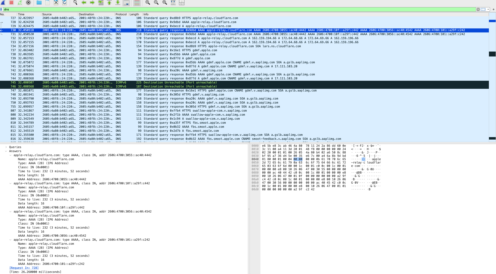
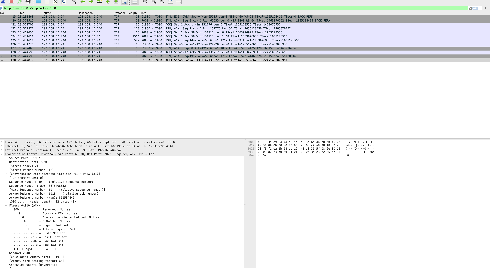
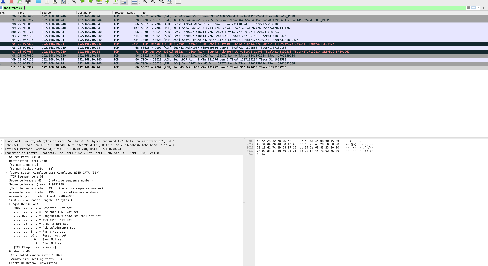
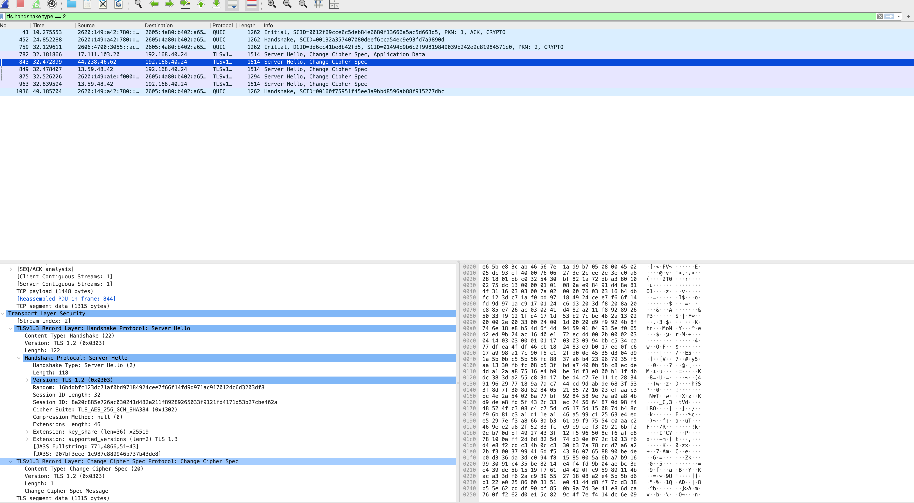

# Wireshark Network Traffic Analysis Lab

## Project Overview
This hands-on cybersecurity project uses Wireshark to capture and analyze network traffic, examine communication protocols, and identify potential network performance issues. The analysis focuses on DNS, TCP connection establishment, TLS encryption handshakes, and TCP retransmissions.

## Tools and Technologies
- Wireshark
- TCP/IP, DNS, TLS 1.3, and ICMPv6
- macOS
- GitHub for project documentation

## Objectives
- Capture and inspect network packets
- Analyze DNS queries and responses
- Examine TCP three-way handshakes
- Identify TCP retransmissions and duplicate acknowledgments
- Inspect TLS handshake messages and negotiated encryption parameters
- Document findings with packet capture screenshots

## Analysis and Findings

### 1. DNS Traffic Analysis
Used Wireshark's `dns` display filter to examine DNS queries and responses, including AAAA records for IPv6 address resolution. Also observed ICMPv6 destination-unreachable messages in the captured traffic.

### 2. TCP Three-Way Handshake
Examined a TCP connection between 192.168.40.24 and 192.168.40.240 using ports 61930 and 7000. Identified SYN, SYN-ACK, and ACK packets used to establish the connection, as well as subsequent data transfer and connection termination.

### 3. TCP Retransmission Analysis
Applied the `tcp.analysis.retransmission` display filter to identify packets Wireshark flagged as retransmissions. Also examined duplicate acknowledgments and TCP sequence numbers. These indicators can help investigate packet loss, delayed acknowledgments, or other network performance issues; retransmissions alone do not establish a root cause.

### 4. TLS Handshake Analysis
Used the `tls.handshake.type == 2` filter to inspect Server Hello messages. Examined a TLS 1.3 handshake, including the supported version, TLS_AES_256_GCM_SHA384 cipher suite, and X25519 key exchange information. Observed encrypted application traffic associated with TLS sessions.

## Skills Demonstrated
- Network packet capture and inspection
- Wireshark display filtering
- TCP/IP protocol analysis
- DNS troubleshooting fundamentals
- TCP connection and retransmission analysis
- TLS handshake inspection
- Technical documentation and evidence collection

## Conclusion
This lab strengthened practical network traffic analysis skills relevant to SOC analysis, network troubleshooting, and cybersecurity operations. The documented packet captures demonstrate foundational experience interpreting network protocols and identifying traffic patterns that warrant further investigation.

## Ethical Scope
Traffic was analyzed for educational purposes using a local lab capture. Findings are limited to the observed packets and do not constitute evidence of malicious activity.
